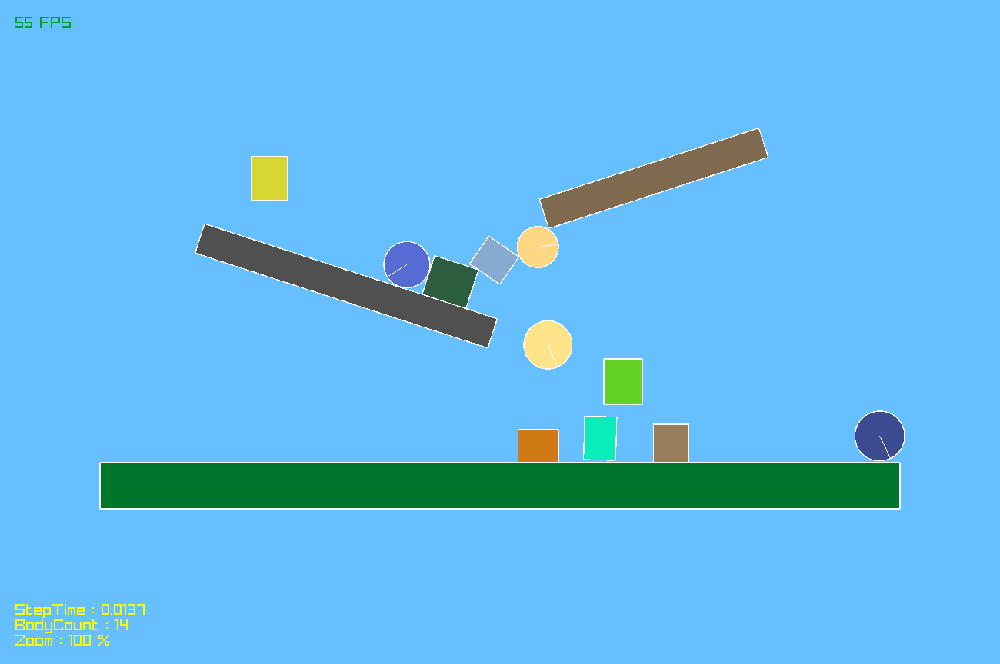
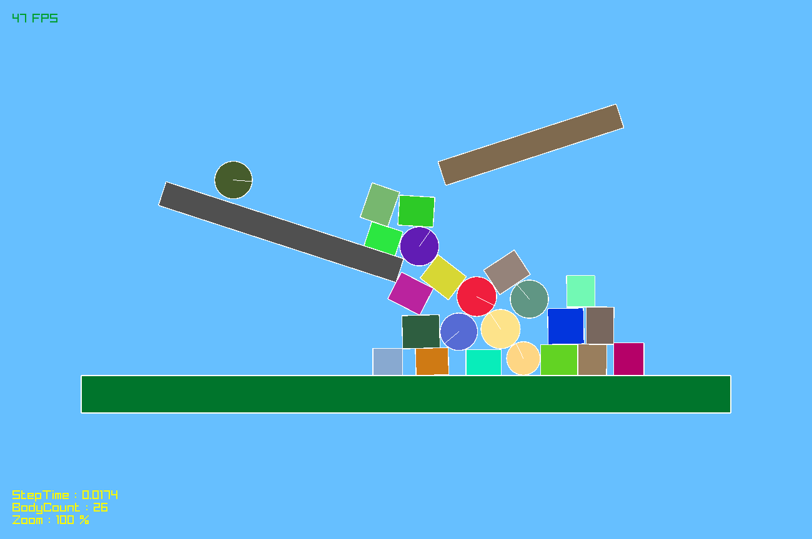
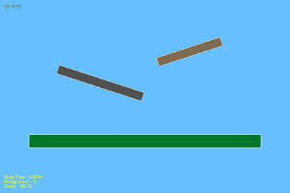
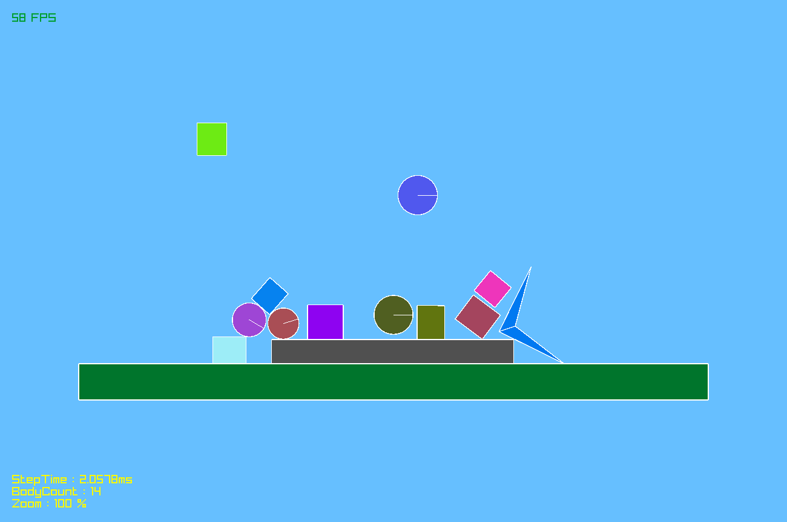
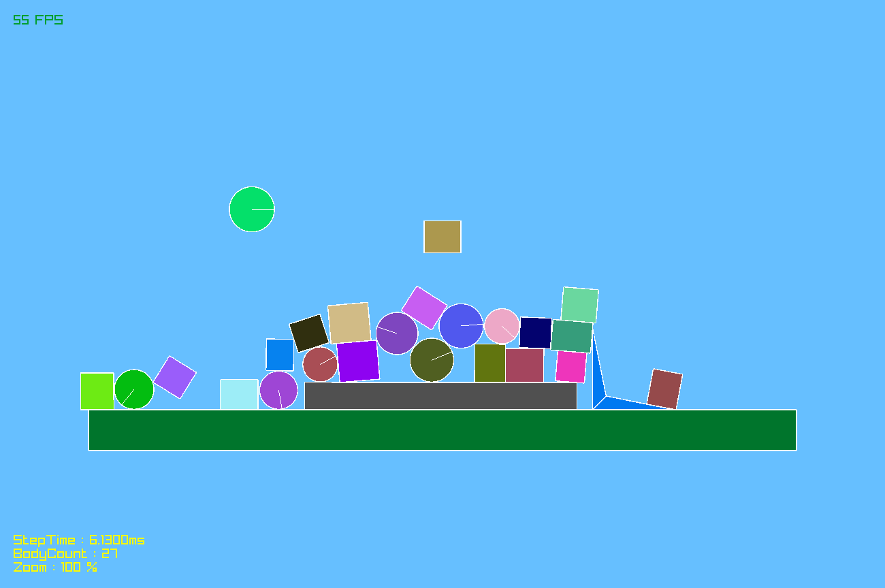
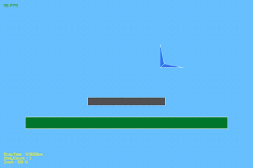

# FlatPhysics

A small 2D rigid-body physics engine in C++, drawn with raylib. Hobby project from 2023, written by
[NaNIsaac](https://github.com/NaNIsaac) alone.

The engine supports circles, boxes, convex polygons and triangulated concave shapes, with
AABB broad phase, SAT collision detection and impulse-based resolution (rotation and friction).
Application: [ShootingGame](https://github.com/NaNIsaac/ShootingGame), a game that runs on a copy of this engine.

## Engine

Shapes dropped with the mouse fall, pile up and slide down the ledges. Both recordings are the running demo
of the commit named under them: left click drops a box, right click a circle.

 



Commit `ee74121` (branch `master`, 2023-03-11): gravity, collision, rotation and friction.

 



Commit `a726fa5` (branch `dev`, 2023-05-20): the same scene with a concave polygon (the blue shape), built
from convex parts.

## Development stages

Dates and commit subjects of the engine's history (`master` until 2023-03-17, then `dev`):

| Date | Commit | Subject |
|---|---|---|
| 2023-03-08 | `75925de` | make force |
| 2023-03-09 | `8d7534d` | gravity |
| 2023-03-11 | `8d2c3ad` | BroadPhase and narrowPhase |
| 2023-03-11 | `24dbbbe` | Add Rotation |
| 2023-03-11 | `ee74121` | Add friction |
| 2023-04-08 | `e003179` | add convex polygon |
| 2023-04-08 | `2755455` | Draw concave polygon |
| 2023-04-08 | `bb051e0` | multibody |
| 2023-04-08 | `d797b2c` | concave entity |
| 2023-05-20 | `a726fa5` | concave |

To run the demo of a stage, check out its commit and build it as described below; the window starts with the
floor and ledges.

## Requirements

- Windows, Visual Studio 2022 with "Desktop development with C++"
- raylib 4.2, bundled as 32-bit headers and libraries in `include/` and `lib/` (`Debug/raylib.dll` is tracked)

## Run

1. Open `FlatPhysics.sln`. The project asks for toolset v142; with only the Visual Studio 2022 tools installed,
   retarget the solution to v143.
2. Select `Debug` / `x86` and run (F5).

Controls: left click drops a box, right click a circle, the mouse wheel zooms, the arrow keys pan the camera
and `T` resets it.

## Structure

- `FlatPhysics/src/Engine/PhysicsEngine/` - bodies, collision, world step
- `FlatPhysics/src/Engine/GameEngine/` - raylib drawing helpers
- `FlatPhysics/src/Game/` - the demo scene (`Application.cpp`, `GameLogic/Game.cpp`)

## Build from the command line

Built on 2026-10-27 from commit `a726fa5` with MSBuild from the Visual Studio 2022 Build Tools, toolset
overridden to v143, without source changes:

```
MSBuild FlatPhysics.sln -p:Configuration=Debug -p:Platform=x86 -p:PlatformToolset=v143
cd FlatPhysics
..\Debug\FlatPhysics.exe
```

## Contributors and branches

Engine: [NaNIsaac](https://github.com/NaNIsaac), alone (`master`, `dev`). The branches `game`, `Kim`,
`Lee` and `Yong` hold the slingshot game that a study group made on the engine on 2023-05-25 and 2023-05-26;
it continues in [ShootingGame](https://github.com/NaNIsaac/ShootingGame), which also lists the study group's
repositories ([2023 spring study group](https://github.com/NaNIsaac/ShootingGame#2023-spring-study-group)).

## License

MIT License, Copyright (c) 2023-2026 NaNIsaac, culee1999 and kimnoa; see [LICENSE](LICENSE). The bundled
raylib 4.2 (`include/`, `lib/`) keeps its own zlib/libpng license.
