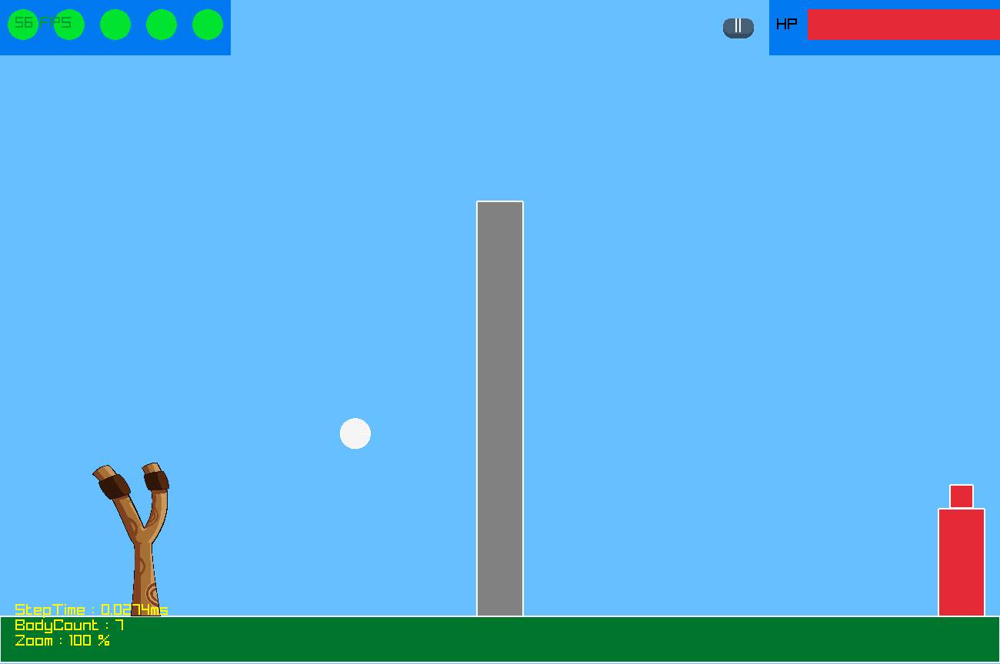

# FlatPhysics

A small 2D rigid-body physics engine in C++, with a slingshot game prototype built on it using raylib.

Hobby project from 2023. The engine was written by NaNIsaac alone; see
[Contributors and branches](#contributors-and-branches) for the game branches.

The engine supports circles, boxes, convex polygons and triangulated concave shapes, with
AABB broad phase, SAT collision detection and impulse-based resolution (rotation and friction).
The `game` branch (default) holds the slingshot prototype; `master` holds the earlier engine demo.

## Screenshots

 


## Requirements

- Windows, Visual Studio 2022 with "Desktop development with C++" (toolset v143)
- raylib 4.2, bundled as 32-bit headers and libraries in `include/` and `lib/`

## Run

1. Open `FlatPhysics.sln`.
2. Run (F5). The build copies `lib\raylib.dll` next to the exe.

The game loads textures from `asset/`, so it must start with `FlatPhysics/` as the working
directory (the Visual Studio default).

## Controls

- Click on the title screen to start
- Drag and release the projectile with the left mouse button to launch it
- Mouse wheel: zoom, arrow keys: pan the camera, `T`: reset the camera
- `||` button: pause menu (`Resume`, `Retry`, `Mainmenu`; `Retry` resumes without resetting the scene)
- `C` / `G`: jump to the game-clear / game-over screen. These debug shortcuts are the only way
  to reach either screen; the HP bar and remaining-shot counter are drawn but never change.

## Structure

- `FlatPhysics/src/Engine/PhysicsEngine/` - bodies, collision, world step
- `FlatPhysics/src/Engine/GameEngine/` - raylib drawing helpers and UI buttons
- `FlatPhysics/src/Game/` - entry point (`Application.cpp`) and game logic

## Build from the command line

Rebuilt on 2026-10-23 without source changes, using MSBuild from the Visual Studio 2022 Build Tools
(MSVC 14.44, toolset v143); only conversion and template warnings were reported:

```
MSBuild FlatPhysics.sln -p:Configuration=Debug
cd FlatPhysics
..\Debug\FlatPhysics.exe
```

The build copies `lib\raylib.dll` into `Debug\`. The window is 1300x864.

## Contributors and branches

- Engine: [NaNIsaac](https://github.com/NaNIsaac), alone. Branches `master` (2023-03, the earlier engine
  demo) and `dev` carry only NaNIsaac's commits.
- Slingshot game on the engine, in the branches `game` (default), `Kim`, `Lee` and `Yong`, made on
  2023-05-25 and 2023-05-26 by a study group of the 2023 spring semester at Sogang University. Its members first wrote a slingshot game
  on their own ([kimnoa/2023_1_project](https://github.com/kimnoa/2023_1_project),
  [culee1999/shooting_game](https://github.com/culee1999/shooting_game), May 2023) and on 2023-05-25 and
  2023-05-26 moved it onto the engine.
  [culee1999](https://github.com/culee1999) (branch `Lee`: pause/retry screens
  and background music button), [kimnoa](https://github.com/kimnoa) (branch `Kim`: scoreboard, menu and
  textbox) and NaNIsaac (branch `Yong`).

The game continues in [ShootingGame](https://github.com/NaNIsaac/ShootingGame), which carries a copy of this
engine. `코드구조.pptx` is the code-structure slide deck of the game.

The study group's other repositories are listed in [ShootingGame](https://github.com/NaNIsaac/ShootingGame#2023-spring-study-group).
